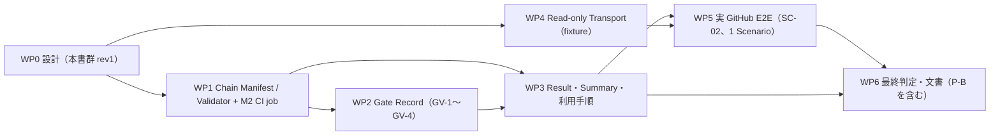

# Phase 2 / M2 — WP1〜WP6 の計画（依存関係、完了条件、必要 Evidence）

* 状態: **WP0 の計画 rev1（Human Review の条件付き承認を受けた修正版）。未実施。** WP1 は Human の実装承認まで開始しない
* 共通: 各 WP の完了条件に `m2-scope-and-baseline.md` §5 の RG-1〜RG-9 と `m2-acceptance-test-matrix.md` §12 の TC-00-01〜04 を含める。各 WP の開始と完了で Human の承認を得る（`development-workflow.md`）。Commit は WP ごとに Human 承認後
* 新規 Code の配置（D-1 で採用）: `iacreview/chain/`（新 Package）。Test は `tests/unit/test_chain_*.py`、期待値は `tests/fixtures/chain_replay/`。既存 Package と Test は変更しない（F-1〜F-7）

## 1. 依存関係

WP4 は WP1〜WP3 と並行できる（共有するのは M1 Collector と `proc.run_bounded` だけで、どちらも変更しない）。

## 2. 各 WP

### WP1 Chain Manifest と Chain Validator

| 項目 | 内容 |
| --- | --- |
| 対象 AC | M2-01〜M2-07、共通 TC-00-01〜04 |
| 作るもの | Manifest Reader（strict JSON、Canonical）、Link 検証（subject、contract、review、verification、github）、Chain Status の合成、Replay 手順、M2 用期待値ファイル、M2 用 CI job と Check Script（§4） |
| 再利用 | `iacreview.remediation.gitsnap`（Git 読み取り）、`iacreview.remediation.report` の Canonical 規則、`iacreview.reportcheck`（Review_Report）、`iacreview.evidence.store` / `integrity`（読み取り）、`iacreview.proc.run_bounded` |
| 開始前の Human 決定 | WP1 の実装承認、Exit code 31〜34 の最終確認（衝突確認は `m2-schemas.md` §3-1）、`ci.yml` への job 追加の承認 |
| 完了条件 | TC-01〜TC-07 と TC-00 がすべて期待どおり。MU2-01〜MU2-20 をすべて検出。RG-1〜RG-9 PASS |
| 必要 Evidence | JUnit（件数・exit code・所要時間）、Mutation 結果、Replay の4つの SHA-256、M1 `expected.json` が不変であることの `git diff`、M1 `evidence_ci_check.py` の exit 0 |

### WP2 Gate Record

| 項目 | 内容 |
| --- | --- |
| 対象 AC | M2-08、M2-09、M2-10（GV-2、静的検査） |
| 作るもの | Gate Record Builder（Raw → Record）、Reader、GV-1〜GV-4 の判定、`gate` Link の合成、`actor_ref` の計算 |
| 開始前の Human 決定 | WP2 の実装承認。`actor_ref` の方式（User id の SHA-256 先頭12桁）の確認 |
| 完了条件 | TC-08、TC-09、TC-10-01〜08 がすべて期待どおり。MU2-21〜MU2-28 を検出。PII canary が出ない。RG-1〜RG-9 PASS |
| 必要 Evidence | JUnit、Mutation 結果、canary 検索の結果 |

### WP3 Chain Result、Summary、利用手順

| 項目 | 内容 |
| --- | --- |
| 対象 AC | M2-06、M2-07 の再確認、M2-10（TC-10-09、Summary） |
| 作るもの | Library API（§5 の C1）、Summary の固定文言、Clean Checkout での Quickstart（合成 Chain）。新 CLI（C2）は §5 の比較に基づく Human の判断が出たら作る |
| 注意 | M1 の `final_report.py` は変更しない（Final Report の bytes が変わり RG-1 が FAILED になる）。Chain の表示は新しい Module に置く |
| 開始前の Human 決定 | 新 CLI の採否（§5）、Summary の文言 |
| 完了条件 | Clean Checkout（`.agents/`・`.kiro/` なし）で Quickstart が動く。Replay の Hash が WP1 と同じ（変わる場合は理由と Human Review）。MU2-29 を検出。RG-1〜RG-9 PASS |
| 必要 Evidence | Clean Checkout での実行記録（Command、exit code、出力の SHA-256）、JUnit |

### WP4 Read-only Transport（fixture まで）

| 項目 | 内容 |
| --- | --- |
| 対象 AC | M2-11 |
| 作るもの | M1 Collector の `Transport` 契約を満たす `gh api` Transport、M2 の Endpoint allowlist、Dry-run |
| 注意 | M1 の `collector.py` は変更しない。Transport は Collector に渡す関数として新 Package に置く |
| 開始前の Human 決定 | WP4 の実装承認、allowlist（`github-e2e-plan.md` §4）の確定、Check Runs を含めるか |
| 完了条件 | TC-11 がすべて期待どおり。MU2-30〜MU2-32 を検出。Test 中に socket が開かないこと。RG-1〜RG-9 PASS |
| 必要 Evidence | JUnit、canary 検索の結果、Mutation 結果 |

### WP5 実 GitHub Read-only E2E（1 Scenario）

| 項目 | 内容 |
| --- | --- |
| 対象 AC | M2-12 |
| 前提 | WP1〜WP4 完了。`github-e2e-plan.md` §9 の Human 承認すべて。§2 の事前確認（SC-02 の Base に対象 Role の Finding が出ること）が PASS |
| 作業 | Human の Repository 操作 → Dry-run 表示の確認 → `--execute`（Human 承認後）→ Chain 組み立て → Replay 4回 → Secret 検査 → PAT Revoke（Human） |
| 完了条件 | E2E-1〜E2E-7 |
| 必要 Evidence | 非公開 Store と Chain Result（`.agents/`）、公開用の要約（Human 承認後）、Human の Revoke 報告 |

### WP6 最終判定と文書

| 項目 | 内容 |
| --- | --- |
| 対象 AC | M2-01〜M2-12 の最終判定 |
| 作るもの | M2 Final AC Matrix（PASS / PARTIAL / FAILED / NOT_PROVEN）、Known Limitations（`m2-threat-model.md` §5 の検出範囲を含む）、`CHANGELOG.md` `[Unreleased]` の追記案、利用者向け文書（英語）、P-B の文書差分案（D-7 承認済み。対象ファイルは適用前に Human に示す） |
| 完了条件 | 全 AC の判定に根拠（Command、exit code、件数、Hash）がある。NOT_PROVEN に理由がある。M1 の判定を書き換えていない。RG-1〜RG-9 PASS |
| 必要 Evidence | 最終の全体 pytest、Benchmark、Determinism、Secret Scan、Public Preflight、M1 `evidence_ci_check.py`、M2 CI job の Run（Agent が確認できない場合は NOT_VERIFIED）、Lint 件数 |

## 3. 停止条件（全 WP）

* RG-1（M1 期待値）が不一致になった → 修正を続けず停止し、Human に報告する
* 既存 Test の失敗、Coverage 80% 未満、Benchmark exit 9 / 10、Determinism 不一致、Secret の検出
* 変更禁止範囲（F-1〜F-7）を変える必要が出た → 停止して Human に委譲
* 同じ方針の修正で2回失敗した
* 計画にない Network アクセス、GitHub への書き込みが必要になった

## 4. M2 専用 CI job（D-5、設計のみ）

| 項目 | 設計 |
| --- | --- |
| Job 名 | `chain-integrity`（案） |
| 追加の時期 | WP1 の完了時。`ci.yml` の変更は Human 承認後（`development-workflow.md`） |
| 実行内容 | `tests/unit/test_chain_*.py` を JUnit 付きで実行し、`.github/scripts/chain_ci_check.py`（新規）が JUnit と `tests/fixtures/chain_replay/expected.json` から、Replay の Hash 一致、必須 Test の SKIP 0、期待値ファイルの変更一覧を判定する |
| M1 からの独立 | `evidence-integrity` job と `evidence_ci_check.py` を変更しない。`needs:` で互いに依存しない（片方の失敗が他方を隠さない）。M1 の `expected.json` を読まない。Check Script の exit code は `evidence_ci_check.py` と重ならない値にする（WP1 で確定） |
| 権限 | Workflow の `permissions: contents: read` のまま。job で上書きしない。`persist-credentials: false`。Secret と Environment を使わない |
| Checkout | 既定の深さで足りる（Chain の Test は合成 Repository を使い、Repository の履歴を読まない） |
| Tool | `local_recompute` の Test に cfn-lint と cfn-guard が要るため、既存 `test` job と同じ Pin と導入手順（`.github/scripts/install_cfn_guard.py`）を使う |
| Python | 3.11 の1組（Replay の bytes は Python Version に依存しない設計。別 Version は既存 `test` job の matrix で Chain の Test が走る） |
| Required Check | 登録しない（Ruleset の変更は M2 の対象外。登録するかは Human） |
| M1 の判定への影響 | `ci.yml` と `.github/scripts/` の変更は M1 Summary の「review required」に出る。`FORBIDDEN_PREFIXES` には入らないため M1 の job は失敗しない（`m2-threat-model.md` §7） |

## 5. CLI の候補比較と、OSS 利用者の導入手順（D-1、判断材料）

前提（Repository で確認した事実）: Plugin は `pip install` の配布をしておらず、`pyproject.toml` に `[project.scripts]` がない。既存の CLI はすべて `PYTHONPATH=<plugin_root> python3 -m <module>` で呼ぶ（README の Delta_Tool、Phase 1 の `iacreview.remediation`、M1 の `iacreview.evidence.replay`）。

| 候補 | 形 | 既存 CLI への影響 | 利点 | 欠点 | 評価 |
| --- | --- | --- | --- | --- | --- |
| C1 | Library API だけ（`iacreview.chain.validate(manifest_path) -> Result` など） | なし | 追加 CLI なし。Test の対象が API そのもの。Agent・CI・Script から同じ関数を呼べる | 利用者が数行の Python を書く。exit code がない（CI の Gate に使うには Script が要る） | **採用を推奨（中核）** |
| C2 | 新 Module CLI `python3 -m iacreview.chain validate <manifest>`（C1 の薄い Wrapper） | なし（新 Module） | 1行で使える。exit code 31〜34 で CI に組み込める。既存 CLI と同じ呼び方 | CLI の引数と exit code が新しい互換性の約束になる | C1 の上に任意で追加。採否は Human |
| C3 | Phase 1 CLI に Subcommand を追加（`python3 -m iacreview.remediation chain …`） | **Phase 1 CLI の変更**（F-5） | 1つの CLI にまとまる | Phase 1 の CLI・Test・53 Case の前提を変える | 不採用 |
| C4 | 新 Skill の `scripts/` | Skill の追加 | Kiro から呼びやすい | `skills/*/scripts/` は v1.0 の Script 一覧の Test（Review_Report の CLI 引数を要求）に入る（Phase 1 design §9 と同じ理由）。Kiro Power の公開は M2 の対象外 | 不採用 |
| C5 | `.github/scripts/chain_ci_check.py` だけ | なし | M2 の CI job に必要 | Repository 自身の CI 用で、利用者向けの製品ではない | CI 用として作る（§4）。利用者向けにはしない |

OSS 利用者の導入手順の比較（合成 Chain の検証まで。Tool は導入済みとする）:

| 手順 | C1 のみ | C1 + C2 |
| --- | --- | --- |
| 1. Plugin の Clone | 必要 | 必要 |
| 2. Python 3.9 以上、PyYAML、git | 必要 | 必要 |
| 3. `local_recompute` を使う場合の cfn-lint / cfn-guard（Profile の Pin） | 必要 | 必要 |
| 4. 実行 | `PYTHONPATH=<plugin_root> python3 -c "from iacreview.chain import validate; …"` か、数行の Script | `PYTHONPATH=<plugin_root> python3 -m iacreview.chain validate <manifest>` |
| 5. CI の Gate にする | 利用者が exit code を返す Script を書く | exit code をそのまま使う |
| Network | 不要（検証は Offline） | 不要 |
| 追加の Dependency | なし | なし |

結論: 追加 CLI なしでも、C1（Library API）で利用できる。手順 1〜3 は C1 と C2 で同じで、違いは実行の1行と、CI で exit code を使えるかだけである。推奨は「C1 を必須、C2 は WP3 で Human が判断」。どちらも既存 CLI は変えない。

## 6. Human 判断の状況

| ID | 事項 | 状況 |
| --- | --- | --- |
| D-1 | `iacreview/chain/` の配置 | 決定（採用）。新 CLI は §5 の比較の後に判断（未決、WP3 開始前） |
| D-2 | Schema の語彙 | 決定（`m2-schemas.md` rev1 で固定）。Exit code 31〜34 は衝突確認済み（Repository 内の検索）、最終確認は WP1 開始前 |
| D-3 | Revision 不一致は BROKEN、Evidence 不足は NOT_PROVEN | 決定（`m2-schemas.md` §2-2） |
| D-4 | SC-02 第一候補、Finding の事前確認、第2 Account 任意 | 決定。検証用 Repository の用意は WP5 開始前 |
| D-5 | M2 専用 CI job | 決定（追加）。`ci.yml` の変更承認は WP1 完了時 |
| D-6 | Version 方針の Steering 反映 | 保留 |
| D-7 | P-B の文書改善 | 承認。適用は WP6 |
| D-8（新） | WP1 の実装開始 | **未承認（停止中）** |
